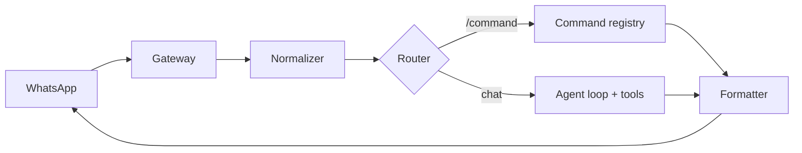

<p align="center">
  
</p>

<h1 align="center">SankaAgent</h1>

<p align="center">
  <strong>Si Kecil Penjelajah Sanankerto</strong><br>
  Asisten acara berbasis AI untuk WhatsApp.
</p>

<p align="center">
  
  
  
  
</p>

> [!NOTE]
> Proyek masih di tahap arsitektur. Belum ada kode aplikasi. Keputusan dan batasan ada di [`docs/`](docs/).

## Kenalan

Sanka membantu panitia dan peserta acara lewat WhatsApp: merekap spreadsheet, membaca PDF/Excel, mencari informasi, dan menyiapkan proposal. Dikembangkan oleh Abdul Muqsith, ditenagai AMQS Studio.

Sanka berjalan hybrid:

- Pesan diawali `/` diproses command deterministik, tanpa LLM.
- Pesan tanpa `/` masuk ke agent AI.
- Di grup, Sanka hanya menjawab saat di-mention, dipanggil `@sanka`, atau di-reply.

## Fitur

| Fitur | Cara kerja |
|---|---|
| Rekap spreadsheet | Angka dihitung di kode (pandas), LLM hanya menarasikan |
| Baca dokumen | PDF, Excel, dan Google Sheets dengan allowlist |
| Web search | Mencari informasi acara dan referensi |
| Proposal | Disusun untuk owner, dikirim hanya setelah `/approve` |
| Persona | Bahasa Indonesia ringkas, tanpa membocorkan reasoning atau trace tool |
| Belajar | Skill dan memori mengikuti pola GenericAgent, dengan asal-usul yang dicatat |

## Arsitektur



- **Gateway** hanya I/O WhatsApp, dengan antrean per chat.
- **Router** memisahkan command dari percakapan dan menegakkan aturan mention.
- **Policy** menentukan peran dan tool yang boleh dipakai.
- **Formatter** adalah satu-satunya jalan keluar: teks final, ringkas, tanpa reasoning.

Detail ada di [`docs/ARCHITECTURE.md`](docs/ARCHITECTURE.md).

## Mulai

Belum ada entrypoint aplikasi. Untuk menyiapkan lingkungan kerja:

```bash
cp config/sanka.example.yaml config/sanka.yaml
cp config/secrets.example.env config/secrets.env
chmod 600 config/secrets.env
```

Secrets tidak pernah masuk git. `config/sanka.yaml` hanya berisi konfigurasi non-secret.

Urutan baca yang disarankan:

1. [`AGENTS.md`](AGENTS.md) — aturan kerja dan batasan keras.
2. [`docs/ADR.md`](docs/ADR.md) — keputusan arsitektur.
3. [`docs/LOG.md`](docs/LOG.md) — posisi pekerjaan terakhir.
4. [`docs/plan/`](docs/plan/) — plan aktif.

## Struktur

```text
core/          harness berbasis GenericAgent
gateway/       gateway WhatsApp untuk Sanka
sanka/         router, commands, policy, formatter, tools, persona
tests/         tes tanpa LLM dan tanpa WhatsApp
docs/          arsitektur, keamanan, persona, command, ADR, LOG, plan
assets/        aset visual
references/    clone upstream untuk studi; di-ignore git
```

## Dokumentasi

| Dokumen | Isi |
|---|---|
| [`AGENTS.md`](AGENTS.md) | Aturan repo, batasan keras, konvensi |
| [`docs/ARCHITECTURE.md`](docs/ARCHITECTURE.md) | Alur pesan, komponen, tool bundle |
| [`docs/SECURITY.md`](docs/SECURITY.md) | Model ancaman, peran, matriks izin |
| [`docs/COMMANDS.md`](docs/COMMANDS.md) | Daftar command dan izinnya |
| [`docs/PERSONA.md`](docs/PERSONA.md) | Karakter Sanka dan draf L0 |
| [`docs/ADR.md`](docs/ADR.md) | Keputusan arsitektur |
| [`docs/LOG.md`](docs/LOG.md) | Catatan sesi kerja |
| [`docs/plan/README.md`](docs/plan/README.md) | Template plan |

## Lisensi

SankaAgent dilisensikan di bawah **MIT License**. Teks lengkap ada di [`LICENSE`](LICENSE).

Copyright (c) 2026 Abdul Muqsith.

## Atribusi dan kepatuhan lisensi

Sanka dibangun dengan belajar dari proyek MIT di bawah ini. **Upstream tidak di-vendor mentah**: kode yang berguna boleh diambil, lalu diubah dan diadaptasi sesuai kebutuhan Sanka. Setiap bagian yang diambil ulang mempertahankan notice copyright aslinya dan ditandai `SANKA-MOD:`; catatannya ada di ADR terkait dan [`docs/LOG.md`](docs/LOG.md).

| Proyek | Pemilik | Lisensi | Peran untuk Sanka |
|---|---|---|---|
| [GenericAgent](https://github.com/lsdefine/GenericAgent) | lsdefine, Copyright (c) 2025 | MIT | Basis arsitektur dan harness: agent loop, layered memory, skill |
| [Hermes Agent](https://github.com/NousResearch/hermes-agent) | Nous Research, Copyright (c) 2025 | MIT | Referensi dan sumber adaptasi untuk gateway WhatsApp |
| [Baileys](https://github.com/WhiskeySockets/Baileys) | Rajeh Taher/WhiskeySockets, Copyright (c) 2025 | MIT | Library koneksi WhatsApp Web untuk bridge Sanka |

Referensi yang dipelajari (commit saat audit 2026-10-20):

- GenericAgent `e6b1bcec92e7789eb80975980b5fd47a2abea860`
- Hermes Agent `0319e113c9602b86ffda350e931cb4b035e1d5d8`

Teks lisensi lengkap tiap proyek tersedia di `LICENSE` masing-masing di dalam clone `references/` dan di repositori resminya. Atribusi ini wajib dipertahankan di distribusi source maupun binary.
