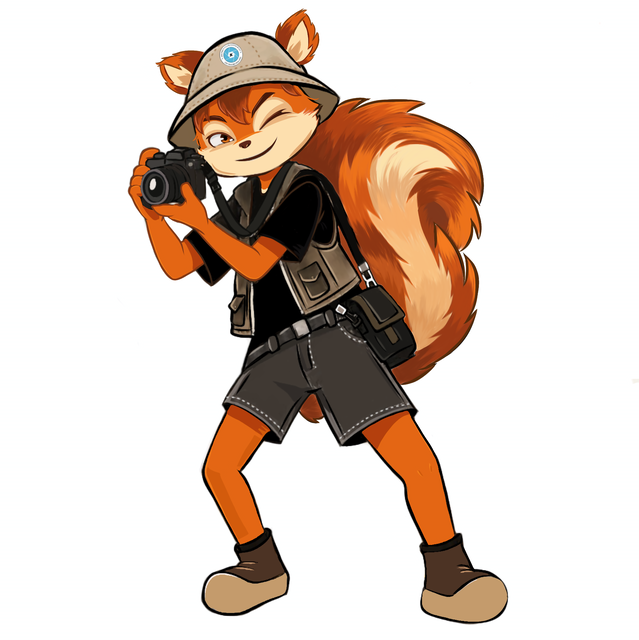
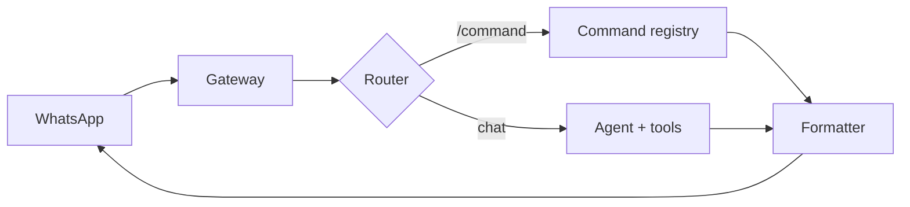

  

<h1 align="center">SankaAgent</h1>

  Asisten AI untuk tim dan komunitas — langsung di WhatsApp. 
  Dikembangkan oleh Abdul Muqsith · AMQS Studio

  
  
  

Sanka mengubah chat jadi ruang kerja: rekap spreadsheet, baca PDF/Excel, telusuri referensi, dan susun proposal. Pesan berawalan `/` diproses sebagai command; pesan lain masuk ke agent AI. Di grup, Sanka hanya menjawab saat di-mention atau di-reply.

## Fitur

- **Rekap data** — angka dihitung di kode, bukan oleh LLM.
- **Dokumen** — PDF, Excel, dan Google Sheets.
- **Riset** — web search untuk referensi dan fakta.
- **Proposal** — dikirim ke owner hanya setelah `/approve`.
- **Output bersih** — teks final saja, tanpa reasoning atau trace tool.

## Arsitektur

Gateway hanya menangani I/O WhatsApp. Router memisahkan command dari percakapan AI. Formatter memastikan yang keluar hanya teks final.

## Status

Tahap fondasi. Plan-1 (config, router, policy, command dasar, formatter) sudah diimplementasikan dan dites tanpa LLM/WhatsApp. Bot WhatsApp dan integrasi LLM belum ada. Rencana kerja ada di [`docs/plan/`](docs/plan/).

Konfigurasi contoh: [`config/sanka.example.yaml`](config/sanka.example.yaml).

## Dokumentasi

| Dokumen | Isi |
|---|---|
| [`AGENTS.md`](AGENTS.md) | Aturan kerja dan batasan proyek |
| [`docs/ARCHITECTURE.md`](docs/ARCHITECTURE.md) | Alur pesan dan komponen |
| [`docs/SECURITY.md`](docs/SECURITY.md) | Peran dan izin tool |
| [`docs/COMMANDS.md`](docs/COMMANDS.md) | Daftar command |
| [`docs/PERSONA.md`](docs/PERSONA.md) | Karakter Sanka |
| [`docs/ADR.md`](docs/ADR.md) | Keputusan arsitektur |
| [`docs/LOG.md`](docs/LOG.md) | Catatan pekerjaan |

## Lisensi

MIT — lihat [`LICENSE`](LICENSE). Copyright (c) 2026 Abdul Muqsith.

Dibangun dengan belajar dari proyek MIT berikut:

| Proyek | Pemilik |
|---|---|
| [GenericAgent](https://github.com/lsdefine/GenericAgent) | lsdefine |
| [Hermes Agent](https://github.com/NousResearch/hermes-agent) | Nous Research |
| [Baileys](https://github.com/WhiskeySockets/Baileys) | Rajeh Taher/WhiskeySockets |

Kode upstream yang dipakai ulang diubah sesuai kebutuhan Sanka, notice lisensinya dipertahankan, dan perubahannya ditandai `SANKA-MOD:`.
