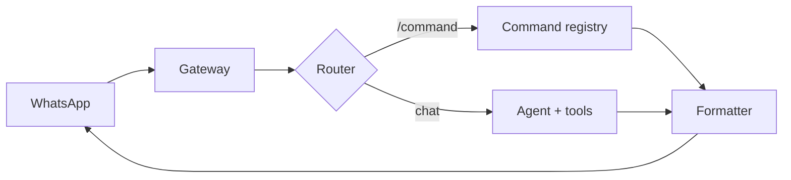

<p align="center">
  
</p>

<h1 align="center">SankaAgent</h1>

<p align="center">
  Asisten AI untuk tim dan komunitas — langsung di WhatsApp.<br>
  Dikembangkan oleh Abdul Muqsith · AMQS Studio
</p>

<p align="center">
  
  
  
</p>

Sanka mengubah chat jadi ruang kerja: rekap spreadsheet, baca PDF/Excel, telusuri referensi, dan susun proposal. Pesan berawalan `/` diproses sebagai command; pesan lain masuk ke agent AI. Di grup, Sanka hanya menjawab saat di-mention atau di-reply.

## Fitur

- **Rekap data** — angka dihitung di kode, bukan oleh LLM.
- **Dokumen** — PDF, Excel, CSV, MD, TXT, dan Google Sheets.
- **Lampiran WhatsApp** — foto/PNG/WebP dibaca lewat model vision; dokumen dibaca lewat `attachment_read`, dicari dengan `attachment_search`, dan dipetakan per bagian dengan `attachment_outline`.
- **Riset** — web search untuk referensi dan fakta.
- **Proposal** — dikirim ke owner hanya setelah `/approve`.
- **Output bersih** — teks final saja, tanpa reasoning atau trace tool.

## Arsitektur



Gateway hanya menangani I/O WhatsApp. Router memisahkan command dari percakapan AI. Formatter memastikan yang keluar hanya teks final.

## Status

Tahap agent core + gateway Python + bridge WhatsApp. Plan-1 (config, router, policy, command dasar, formatter), plan-2 (sesi per chat, antrean, client OpenCode Go, `/new`, `/stop`), dan plan-3 (gateway Python loopback) selesai; plan-2 sudah diverifikasi live ke OpenCode Go. Plan-4 (bridge Node/Baileys) sudah dipasangkan ke nomor Sanka dan berhasil membalas mention grup; DM/no-mention/logout masih diuji. Plan-5 (tool baca + rekap) sudah terintegrasi; `web_search` via SearXNG dan `doc_read` sudah live, sedangkan `/rekap` dengan sheet Google nyata menunggu kredensial. Plan-12 (lampiran masuk: gambar + dokumen) sudah diimplementasikan dan lolos smoke loopback dengan model nyata; smoke WhatsApp nyata menunggu owner. Plan-15 menambahkan `attachment_search` dan `attachment_outline` untuk dokumen besar (ADR-0028). Rencana kerja ada di [`docs/plan/`](docs/plan/), peta plan di [`docs/plan/ROADMAP.md`](docs/plan/ROADMAP.md).

Konfigurasi contoh: [`config/sanka.example.yaml`](config/sanka.example.yaml). Lampiran diatur di section `attachments`; `dir: ""` mematikan fitur, sedangkan direktori absolut di luar repo mengaktifkannya.
Persona runtime: [`config/SOUL.md`](config/SOUL.md). Edit file itu untuk mengubah karakter Sanka; `prompt.py` memuatnya saat startup dan gagal cepat bila file hilang.

## Menjalankan

```bash
scripts/sanka start               # gateway + bridge di background
scripts/sanka start gateway       # hanya gateway
scripts/sanka start bridge        # hanya bridge
scripts/sanka status              # PID + health keduanya
scripts/sanka restart             # restart gateway + bridge
scripts/sanka restart bridge      # restart bridge saja
scripts/sanka logs                # ikuti log gateway dan bridge
scripts/sanka logs bridge         # ikuti salah satu
scripts/sanka pair                # bridge di foreground untuk scan QR pertama
```

Log dan PID ada di `logs/` (gitignored). `start bridge` memakai sesi WhatsApp yang sudah ada; pairing pertama tetap lewat `scripts/sanka pair`.

Konteks grup ambient (opsional) diatur di `group_context` pada config. `enabled: true` + `capture_all_groups: true` membuat Sanka mencatat teks semua grup yang diikutinya; gunakan `capture_group_ids` untuk membatasi. Data disimpan di luar repo dengan retensi 24 jam. Lihat ADR-0025 dan `docs/SECURITY.md`.

## Dokumentasi

| Dokumen | Isi |
|---|---|
| [`AGENTS.md`](AGENTS.md) | Aturan kerja dan batasan proyek |
| [`docs/ARCHITECTURE.md`](docs/ARCHITECTURE.md) | Alur pesan dan komponen |
| [`docs/SECURITY.md`](docs/SECURITY.md) | Peran dan izin tool |
| [`docs/COMMANDS.md`](docs/COMMANDS.md) | Daftar command |
| [`docs/PERSONA.md`](docs/PERSONA.md) | Karakter Sanka |
| [`docs/ADR.md`](docs/ADR.md) | Keputusan arsitektur |
| [`docs/LOG.md`](docs/LOG.md) | Catatan pekerjaan |

## Lisensi

MIT — lihat [`LICENSE`](LICENSE). Copyright (c) 2026 Abdul Muqsith.

Dibangun dengan belajar dari proyek MIT berikut:

| Proyek | Pemilik |
|---|---|
| [GenericAgent](https://github.com/lsdefine/GenericAgent) | lsdefine |
| [Hermes Agent](https://github.com/NousResearch/hermes-agent) | Nous Research |
| [Baileys](https://github.com/WhiskeySockets/Baileys) | Rajeh Taher/WhiskeySockets |

Kode upstream yang dipakai ulang diubah sesuai kebutuhan Sanka, notice lisensinya dipertahankan, dan perubahannya ditandai `SANKA-MOD:`.
