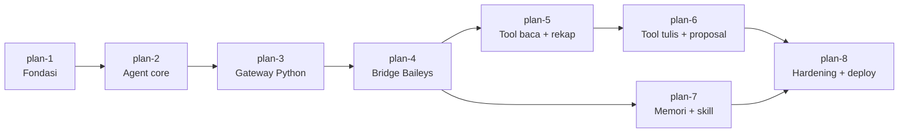

# Roadmap Plan — SankaAgent

Dokumen ini adalah peta plan, bukan plan kerja. Detail teknis tetap ada di `plan-N.md`.
Roadmap ini menggantikan tabel "Rencana lanjutan (indikatif)" di plan-1.

- Status: Draft untuk disetujui owner
- Tanggal: 2026-10-21
- Jumlah plan: **8** (plan-1 sampai plan-8)

## Prinsip urutan

1. Satu plan, satu tujuan. Plan berikutnya baru berstatus `In Progress` setelah plan sebelumnya `Done`, kecuali owner memutuskan lain.
2. Setiap plan harus bisa dites tanpa layanan eksternal bila memungkinkan. Layanan nyata dipakai untuk smoke test, bukan satu-satunya bukti.
3. Dependency baru dicatat di plan yang memakainya.
4. Keputusan arsitektur dicatat sebagai ADR sebelum atau saat plan berjalan.
5. Tidak ada reasoning, trace tool, atau secret yang keluar ke WhatsApp.

## Peta plan

Urutan eksekusi tetap linear: 1 → 2 → 3 → 4 → 5 → 6 → 7 → 8.
Panah hanya menunjukkan prasyarat; plan-7 secara teknis bisa dikerjakan sebelum plan-6.

## Fase A — Inti yang bisa dipakai (plan-1 sampai plan-4)

Target fase: bot WhatsApp benar-benar hidup, bisa menjawab DM dan grup yang di-mention, dengan command dan agent yang sama seperti rencana.

### Plan 1 — Fondasi deterministik (Done)

- Isi: config, router, policy, command registry dasar, formatter, tes.
- Keluar: `pytest` lulus, tidak ada ketergantungan LLM/WhatsApp.
- Status: selesai 2026-10-20.

### Plan 2 — Agent core: sesi, antrean, OpenCode Go (Draft)

- Isi: sesi per chat, antrean serial per chat, `/new` dan `/stop`, client OpenCode Go, adaptasi `agent_loop.py`, `AgentRuntime`.
- Keluar: `AgentRuntime.handle()` teruji dengan client palsu; satu request nyata ke OpenCode Go berhasil; reasoning tidak pernah keluar.
- Prasyarat: ADR-0015/0016/0017 disetujui.

### Plan 3 — Gateway Python dan normalizer

- Isi: kontrak inbound/outbound dengan bridge, normalizer payload menjadi `InboundMessage`, deduplikasi `message_id`, allowlist grup, penerapan peran dan rate limit untuk command dan agent, pengiriman balasan lewat formatter, antrean keluar, typing/read receipt (tanpa isi pesan di log).
- Keluar: uji end-to-end dengan bridge palsu: pesan masuk → command/agent → balasan terformat; duplikat tidak diproses dua kali; grup tanpa mention diabaikan; reasoning tidak bocor.
- Sengaja belum: koneksi WhatsApp nyata.

### Plan 4 — Bridge WhatsApp Web (Node + Baileys)

- Isi: proses Node terpisah, pairing/QR, penyimpanan sesi di luar repo (0600), reconnect dengan backoff, endpoint kirim/typing, deteksi mention dan reply, idempotensi kirim, penanganan media minimal.
- Keluar: satu DM dan satu grup nyata bisa memakai Sanka; restart bridge menyambung ulang tanpa pairing ulang; tidak ada logika bisnis di Node; sesi WhatsApp tidak masuk git.
- Risiko: jalur tidak resmi, nomor bisa diblokir. Mitigasi: rate limit, tanpa broadcast, perilaku non-spam.

**Definisi "bot inti hidup"**: akhir plan-4. Pengguna bisa `/ping`, `/help`, `/whoami`, `/status`, `/new`, `/stop`, dan mengobrol dengan agent di DM atau grup yang di-mention.

## Fase B — Fitur kerja tim (plan-5 sampai plan-6)

### Plan 5 — Tool baca dan rekap

- Isi: tool registry dengan izin per peran (penegakan ganda: skema ke LLM dan penolakan saat eksekusi), skema input/output, `web_search`, `doc_read` (PDF/Excel), `sheet_read`, `recap` yang menghitung di kode (pandas), Google service account read-only + allowlist, formatter `RECAP`.
- Keluar: panitia bisa meminta rekap dari sheet terdaftar; angka berasal dari hasil hitung kode; peserta ditolak; tidak ada akses di luar allowlist; tes memakai fixture, bukan data asli.
- Prasyarat: plan-4 (jalur WhatsApp nyata) dan ADR-0011 (matriks izin) disetujui.

### Plan 6 — Tool tulis dan alur proposal

- Isi: `sheet_write` hanya ke allowlist, `proposal_send` dengan `/proposal list`, `/approve`, `/reject`, audit log, idempotensi pengiriman, batas kirim keluar.
- Keluar: tulis tidak bisa keluar dari allowlist; proposal tidak terkirim tanpa persetujuan owner; percobaan ganda tidak mengirim dua kali; semua aksi tercatat tanpa isi pesan pribadi.
- Prasyarat: plan-5 (registry dan allowlist sudah terbukti).

## Fase C — Belajar dan produksi (plan-7 sampai plan-8)

### Plan 7 — Memori, skill, dan persona L0

- Isi: persona L0 final dari `docs/PERSONA.md`; memori berlapis turunan GenericAgent (L1/L2/L3/L4); kebijakan apa yang boleh masuk memori lintas chat, termasuk batas isi DM; pencatatan asal-usul; `/skill list` dan `/skill rm` untuk owner; pertahanan prompt injection; toggle self-evolution.
- Keluar: memori lintas sesi bekerja; `/new` hanya mereset sesi, bukan memori; isi DM tidak bocor ke grup sesuai kebijakan; skill bisa diaudit dan dihapus owner.
- Prasyarat: plan-4 (pemakaian nyata) dan keputusan owner tentang lingkup memori (ADR-0008/0011).
- Catatan: ini plan paling berisiko. Jangan aktifkan self-evolution sebelum kebijakan memori disetujui.

### Plan 8 — Hardening dan deployment

- Isi: tool istimewa (browser dengan profil khusus, `code_run`, `file_write`, shell dengan toggle), manajemen secret, redaksi log, backup, supervisor (systemd/container), health check, uji beban/soak, review keamanan, runbook insiden, rilis.
- Keluar: berjalan di bawah supervisor dan pulih setelah restart; log tidak memuat pesan pribadi atau secret; shell nonaktif secara default; owner bisa mengulang proses deploy; tidak ada temuan kritis dari review keamanan.

## Kenapa 8, bukan 6

Tabel lama di plan-1 menggabungkan beberapa pekerjaan besar dalam satu plan:

- Gateway Python dan bridge Baileys dipisah agar normalizer, izin, dan formatter bisa dites tanpa WhatsApp nyata (plan-3), sementara koneksi nyata punya plan sendiri (plan-4).
- Tool baca/rekap dan tool tulis/proposal dipisah karena keduanya punya risiko dan izin berbeda (plan-5 dan plan-6).
- Hardening dan deployment dipisah dari proposal agar tidak menjadi plan raksasa yang sulit ditinjau (plan-8).

Dengan pemisahan ini, setiap plan punya hasil yang bisa diamati dan diff yang masih bisa dibaca owner.

## Yang tidak direncanakan (belum)

- WhatsApp Cloud API resmi (tetap opsi cadangan ADR-0013).
- Dashboard web, multi-tenant, multi-bot.
- MCP, multi-proses, broker eksternal.
- Voice note, image generation, dan analisis media lanjutan.
- Model fallback otomatis dan manajemen kuota lintas provider.
- Automasi pengiriman massal atau broadcast.

## Status ringkas

| Plan | Nama | Status |
|---|---|---|
| 1 | Fondasi deterministik | Done |
| 2 | Agent core | Done — live smoke OpenCode Go berhasil |
| 3 | Gateway Python | Draft |
| 4 | Bridge Baileys | Draft |
| 5 | Tool baca + rekap | Draft |
| 6 | Tool tulis + proposal | Draft |
| 7 | Memori + skill | Draft |
| 8 | Hardening + deploy | Draft |

## Langkah berikutnya

1. Owner meninjau hasil plan-2 dan seluruh draft plan-3 sampai plan-8.
2. Plan-2 sudah `Done`; live smoke OpenCode Go berhasil. Berikutnya owner meninjau plan-3 dan mengubah statusnya menjadi `In Progress` bila disetujui.
3. Plan-3 boleh dipecah paralel per modul (`normalizer`, `dedup`, `gate`, `outbound`, `dispatcher`, `server`) selama kontrak di plan-3 tidak berubah.
4. Plan-4 sampai plan-8 tetap berurutan karena saling bergantung. Paralelisasi hanya dilakukan untuk slice di dalam satu plan, bukan antarplan yang belum punya antarmuka stabil.
