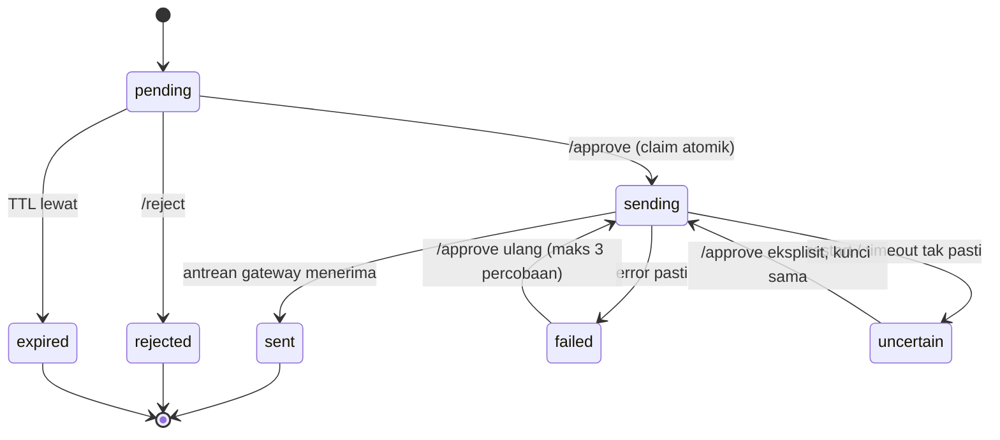

# Plan 6 — Tool tulis dan alur proposal

- Status: Draft
- Tanggal: 2026-10-21
- Pemilik: Abdul Muqsith

## Tujuan

Menambahkan dua kemampuan yang mengubah keadaan di luar Sanka: `sheet_write` ke spreadsheet yang ada di write allowlist, dan proposal yang dibuat agent tetapi **hanya dikirim setelah owner menyetujuinya**.
Plan ini memisahkan dua fase secara tegas: tool hanya *menyiapkan* proposal (state `pending`), sedangkan pengiriman hanya terjadi lewat command owner `/approve`.
State proposal disimpan durable di SQLite stdlib, sehingga persetujuan tetap berlaku setelah restart dan percobaan ganda tidak mengirim dua kali.
Semua aksi tulis dan persetujuan dicatat sebagai audit metadata tanpa isi pesan, tanpa argumen, dan tanpa secrets.

## Di luar cakupan

- Tool baca, rekap, dan registry tool itu sendiri. Registry, `ToolSpec`, penolakan izin saat eksekusi, dan backend Google read berasal dari plan-5 dan dipakai apa adanya.
- Bridge WhatsApp dan pengiriman nyata. Plan ini hanya memakai antarmuka pengirim dari plan-3/plan-4.
- Template dokumen proposal (docx/PDF), lampiran media, dan tanda tangan digital. Proposal di plan ini adalah teks satu pesan.
- Persetujuan berlapis (dua owner), jadwal kirim, dan pembatalan setelah terkirim.
- `code_run`, `file_write`, shell, dan browser (plan-8).
- Memori, skill, dan persona L0 final (plan-7).
- Antrean keluar, retry jaringan, dan typing indicator. Itu milik gateway (plan-3/plan-4); plan ini hanya memberi `base_key` idempoten.
- Multi-proses dan multi-bot. Satu proses Python, satu file SQLite.

## Prasyarat

- **ADR-0011 berstatus `Accepted`.** Matriks izin, allowlist Workspace, dan aturan "pengiriman proposal butuh `/approve`" adalah dasar plan ini. Selama ADR-0011 masih `Proposed`, plan ini tidak boleh masuk `In Progress`.
- **ADR-0020 disetujui owner** (diusulkan oleh plan ini): proposal sebagai state machine dua fase dengan penyimpanan durable di SQLite. Lihat bagian Rancangan.
- **plan-5 `Done`**: `sanka/tools/registry.py` sudah menegakkan izin per peran saat eksekusi (`ToolSpec`, `ToolContext`, `ToolResult`, `ToolError`, `ToolRegistry.specs_for/execute`), dan adapter Google Sheets read berbasis `httpx` sudah ada. Plan ini memakai kontrak itu apa adanya dan tidak membuat registry kedua.
- **Bentuk allowlist dari plan-5**: `workspace.read_allowlist` menjadi daftar `{alias, spreadsheet_id}` dan tidak ada tool yang menerima `spreadsheet_id` mentah. Plan-6 mengikuti bentuk yang sama untuk `write_allowlist`; parser alias-nya dipakai bersama, bukan disalin.
- **plan-4 `Done`**: endpoint kirim bridge menerima `idempotency_key` dan mengembalikan pesan yang sama bila kunci itu diulang. Tanpa ini, jaminan "tidak terkirim dua kali" hanya berlaku di sisi Sanka, bukan di sisi WhatsApp.
- **plan-2 `Done`**: `AgentRuntime.handle()`, `CommandRegistry`, dan `build_registry(control)` sudah ada.
- Service account Google sudah diberi hak **edit** pada file yang masuk `workspace.write_allowlist`. Service account read-only dari plan-5 tidak cukup untuk menulis; ini keputusan owner, bukan perubahan kode.
- `config/sanka.yaml` sudah memuat `workspace.write_allowlist` dan `access.allowed_group_ids` yang terisi.

## Rancangan

### Struktur file

```text
sanka/
  storage.py              # direktori privat, koneksi SQLite, cek permission, migrasi DDL
  audit.py                # AuditEvent, SqliteAuditLog, actor_ref()
  outbound.py             # ProposalSender, OutboundQueueSender, SendError, OutboundLimiter
  proposals.py            # ProposalStatus, Proposal, ProposalStore, ClaimOutcome
  proposal_service.py     # ProposalService: prepare/approve/reject/list/sweep
  targets.py              # validasi target kirim (owner_dm | group)
  tools/
    proposal_tool.py      # tool proposal_prepare (tidak mengirim)
    sheet_write.py        # tool sheet_write + guard allowlist
  commands/
    proposal.py           # /proposal list, /approve, /reject
config/
  sanka.example.yaml      # tambah section proposal
tests/
  test_storage.py
  test_audit.py
  test_proposals_store.py
  test_proposal_service.py
  test_proposal_commands.py
  test_proposal_tool.py
  test_sheet_write.py
  test_targets.py
```

### Alur

```text
FASE 1 — menyiapkan (tool, tidak mengirim)

owner: "buat proposal rundown untuk grup panitia"
   -> agent memanggil tool proposal_prepare(target_kind, target, title, body)
   -> ProposalService.prepare()
        validasi target + panjang body
        INSERT proposals(status='pending')
        audit(proposal.prepare, ok)
   -> ToolResult(status='pending', proposal_id)
   -> agent membalas draft + id ke owner (teks final lewat formatter)

FASE 2 — menyetujui dan mengirim (command, owner saja)

owner: /approve <id>
   -> CommandRegistry (roles={OWNER}) -> ProposalService.approve()
        1. claim atomik: pending -> sending      (UPDATE ... WHERE status='pending')
        2. cek OutboundLimiter (limits.outbound_per_minute)
        3. OutboundQueue.enqueue_reply(target_chat_id, [body], base_key=f"proposal:{id}")
        4. sending -> sent (diterima antrean gateway)
        exception saat enqueue -> failed; exception yang bisa berarti sudah masuk -> uncertain
   -> balasan status ke owner
```



### Antarmuka

Registry tool, `ToolSpec`, `ToolContext`, dan `ToolResult` berasal dari plan-5. Plan ini menambah dua tool dan memakai kontraknya tanpa variasi.

```python
# sanka/outbound.py
class ProposalSender(Protocol):
    def send_proposal(self, chat_id: str, messages: Sequence[str], *,
                      base_key: str) -> None: ...

class OutboundQueueSender:
    """Adapter tipis di atas gateway.outbound.OutboundQueue (plan-3)."""
    def __init__(self, queue: OutboundQueue) -> None
    def send_proposal(self, chat_id: str, messages: Sequence[str], *,
                      base_key: str) -> None

class SendError(Exception):
    code: str            # "queue_rejected" | "queue_unavailable" | ...
    uncertain: bool      # True bila pesan mungkin sudah masuk antrean

class OutboundLimiter:
    def __init__(self, per_minute: int, *, clock: Callable[[], float] = time.monotonic) -> None
    def allow(self) -> bool
```

Plan-3 hanya menyediakan `OutboundQueue.enqueue_reply(chat_id, messages, *, base_key)` yang fire-and-forget: tidak ada ack pengiriman dan tidak ada id pesan. Karena itu `sent` di plan-6 berarti **"diterima antrean keluar gateway"**, bukan "sampai di WhatsApp". Bukti sampai di sisi WhatsApp baru bisa ada setelah plan-4/bridge menyediakan status; itu tidak dijanjikan di sini.
Gateway menurunkan kunci wire `f"{base_key}:{index}"`; untuk body satu pesan, kuncinya `proposal:<id>:0` dan stabil sepanjang umur proposal. Bridge mengembalikan 409 untuk kunci yang sudah selesai, dan gateway memperlakukannya sebagai sukses (kontrak plan-3/plan-4).

```python
# sanka/proposals.py
class ProposalStatus(str, Enum):
    PENDING = "pending"; SENDING = "sending"; SENT = "sent"; FAILED = "failed"
    REJECTED = "rejected"; EXPIRED = "expired"; UNCERTAIN = "uncertain"

@dataclass(frozen=True, slots=True)
class Proposal:
    id: str
    chat_id: str
    creator_id: str
    target_kind: str          # "owner_dm" | "group"
    target_chat_id: str
    title: str
    body: str
    status: ProposalStatus
    created_at: datetime
    expires_at: datetime
    updated_at: datetime
    attempts: int
    gateway_base_key: str | None
    last_error_code: str | None

class ClaimOutcome(str, Enum):
    OK = "ok"; NOT_FOUND = "not_found"; NOT_PENDING = "not_pending"
    EXPIRED = "expired"; RETRY_LIMIT = "retry_limit"

class ProposalStore:
    def __init__(self, db_path: Path, *, clock: Callable[[], datetime] = _utcnow,
                 ttl_hours: int, stale_sending_seconds: int) -> None
    def prepare(self, *, chat_id: str, creator_id: str, target_kind: str,
                target_chat_id: str, title: str, body: str) -> Proposal
    def get(self, proposal_id: str) -> Proposal | None
    def list_pending(self, *, limit: int = 20) -> tuple[Proposal, ...]
    def claim(self, proposal_id: str, *, approver_id: str,
              allow_retry: bool = False) -> ClaimOutcome
    def release_claim(self, proposal_id: str) -> None       # limiter menolak: sending -> pending
    def mark_sent(self, proposal_id: str) -> None
    def mark_failed(self, proposal_id: str, error_code: str) -> None
    def mark_uncertain(self, proposal_id: str, error_code: str) -> None
    def reject(self, proposal_id: str, *, actor_id: str) -> bool
    def expire_due(self) -> int
    def recover_stale(self) -> int                          # sending basi -> uncertain
    def purge_bodies(self) -> int
    def close(self) -> None
```

```python
# sanka/proposal_service.py
@dataclass(frozen=True, slots=True)
class PrepareResult:
    ok: bool
    proposal_id: str | None = None
    expires_at: datetime | None = None
    error_code: str | None = None      # target_not_allowed | too_many_pending | too_large | invalid_arguments

class ApproveResult(str, Enum):
    SENT = "sent"
    IN_PROGRESS = "in_progress"
    ALREADY_SENT = "already_sent"
    NOT_FOUND = "not_found"
    EXPIRED = "expired"
    RATE_LIMITED = "rate_limited"
    RETRY_LIMIT = "retry_limit"
    FAILED = "failed"
    UNCERTAIN = "uncertain"

class RejectResult(str, Enum):
    REJECTED = "rejected"
    NOT_FOUND = "not_found"
    NOT_PENDING = "not_pending"

class ProposalService:
    def __init__(self, store: ProposalStore, sender: ProposalSender,
                 limiter: OutboundLimiter, audit: AuditLog, *,
                 access: AccessConfig, max_pending: int, max_body_chars: int,
                 max_reply_chars: int, clock: Callable[[], datetime] = _utcnow) -> None
    def prepare(self, *, chat_id: str, creator_id: str, target_kind: str,
                target: str, title: str, body: str) -> PrepareResult
    def approve(self, proposal_id: str, *, sender_id: str) -> ApproveResult
    def reject(self, proposal_id: str, *, sender_id: str) -> RejectResult
    def list_pending(self) -> str                            # teks siap kirim
```

```python
# sanka/tools/proposal_tool.py
PROPOSAL_PREPARE_SPEC: ToolSpec   # name="proposal_prepare"
# input: target_kind (owner_dm|group), target, title, body
# handler: (arguments, context) -> ToolResult, hanya memanggil ProposalService.prepare()
```

Nilai `data` pada hasil sukses:

```json
{
  "proposal_id": "<id>",
  "status": "pending",
  "expires_at": "<ISO-8601 UTC>",
  "note": "menunggu persetujuan owner; tool ini tidak mengirim"
}
```

```python
# sanka/tools/sheet_write.py
class SheetWriter(Protocol):
    """Bagian tulis dari adapter Google Sheets plan-5 (httpx REST, values.append/update)."""
    def append_rows(self, spreadsheet_id: str, tab: str,
                    rows: Sequence[Sequence[str]], *,
                    value_input_option: str = "RAW") -> Mapping[str, Any]: ...
    def update_range(self, spreadsheet_id: str, tab: str, cell_range: str,
                     rows: Sequence[Sequence[str]], *,
                     value_input_option: str = "RAW") -> Mapping[str, Any]: ...

SHEET_WRITE_SPEC: ToolSpec   # name="sheet_write"; input: alias, tab, mode, cell_range, rows
# handler: (arguments, context) -> ToolResult, signature mengikuti ToolSpec.handler plan-5

class SheetWriteTool:
    def __init__(self, writer: SheetWriter, *,
                 write_allowlist: Mapping[str, str]) -> None   # alias -> spreadsheet_id
    def handle(self, arguments: Mapping[str, Any], context: ToolContext) -> ToolResult
```

`SheetWriter` konkretnya adalah method baru pada adapter `httpx` Google Sheets yang dibuat plan-5 (`values.append` dan `values.update` dengan `valueInputOption=RAW`). Plan ini tidak membuat klien Google kedua dan tidak memakai `google-api-python-client`.

### Balasan command

| Hasil | Balasan owner |
|---|---|
| `PrepareResult.ok` | `Proposal <id> disiapkan. Menunggu persetujuan.` |
| `target_not_allowed` | `Tujuan kirim tidak diizinkan.` |
| `too_many_pending` | `Terlalu banyak proposal menunggu. Selesaikan yang lama dulu.` |
| `too_large` | `Isi proposal terlalu panjang untuk satu pesan.` |
| `SENT` | `Proposal <id> terkirim ke antrean.` |
| `IN_PROGRESS` | `Proposal <id> sedang diproses.` |
| `ALREADY_SENT` | `Proposal <id> sudah terkirim.` |
| `NOT_FOUND` | `Proposal <id> tidak ditemukan.` |
| `EXPIRED` | `Proposal <id> sudah kedaluwarsa.` |
| `RATE_LIMITED` | `Batas kirim keluar tercapai. Coba lagi nanti.` |
| `RETRY_LIMIT` | `Proposal <id> sudah dicoba 3 kali. Buat proposal baru.` |
| `FAILED` | `Proposal <id> gagal diserahkan. Coba /approve lagi.` |
| `UNCERTAIN` | `Status proposal <id> tidak pasti. Jalankan /approve lagi untuk mengirim ulang dengan kunci yang sama.` |
| `/proposal list` kosong | `Tidak ada proposal menunggu.` |
| `/proposal list` berisi | Satu baris per proposal: `<id> · <grup|DM owner> · <umur> · <judul dipotong 60 karakter>` |
| `/reject` | `Proposal <id> ditolak.` |

Balasan tidak pernah memuat body proposal dan tidak pernah menyebut nomor telepon target.

### Keputusan teknis

1. **Nama tool: `proposal_prepare`, bukan `proposal_send`.**
   `docs/ARCHITECTURE.md` dan `docs/SECURITY.md` menyebut `proposal_send`, tetapi nama itu menyiratkan tool bisa mengirim. Karena aturan keras repo adalah "tidak ada pengiriman otomatis", tool dinamai `proposal_prepare` dan hanya membuat state `pending`.
   Kunci `TOOL_PERMISSIONS` di `sanka/policy.py` diganti dari `proposal_send` menjadi `proposal_prepare` (peran tetap owner), dan kedua dokumen diperbarui di plan ini. Alternatif (mempertahankan nama lama dengan arti baru) ditolak karena menyesatkan LLM.

2. **Penyimpanan: SQLite stdlib `sqlite3`, bukan JSON atomik.**
   Transisi status butuh compare-and-set. `UPDATE proposals SET status='sending' WHERE id=? AND status='pending'` hanya berhasil untuk satu pemanggil, sehingga dua `/approve` paralel dari dua chat tidak mungkin sama-sama mengirim.
   Dengan file JSON, penulisan ulang seluruh file saat dua thread menyetujui bersamaan bisa kehilangan salah satu transisi, dan riwayat kejadian harus disusun ulang di kode. SQLite memberi transaksi, indeks untuk sweep kedaluwarsa, dan primary key sebagai penjaga duplikasi tanpa dependency baru.
   Alasan tambahan: audit log butuh append murah dan query berdasarkan subjek.
   Konsekuensi yang diterima: satu penulis (satu proses), file DB harus di-backup bersama state lain, dan isi body tersimpan lokal.

3. **Dua fase, satu klaim, dan I/O di luar transaksi.**
   `approve()` memakai `BEGIN IMMEDIATE` untuk klaim, lalu **menutup transaksi sebelum** memanggil `enqueue_reply()`. Tidak ada lock DB yang dipegang saat antrean gateway bekerja (termasuk HTTP ke bridge). Hasil penyerahan ditulis lewat UPDATE bersyarat (`WHERE status='sending'`), sehingga hasil dari percobaan yang sudah digantikan tidak bisa menimpa state baru.

4. **Idempotensi pengiriman.**
   `base_key = f"proposal:{id}"` stabil untuk seluruh umur proposal. Plan-3 menurunkan kunci wire `proposal:<id>:<index>` per potongan pesan dan meneruskannya ke bridge; bridge mengembalikan 409 untuk kunci yang sudah selesai, yang diperlakukan gateway sebagai sukses (kontrak plan-3/plan-4).
   `/approve` kedua pada proposal `sent` hanya membaca state dan membalas "sudah terkirim"; tidak ada panggilan `enqueue_reply`.
   Konsekuensi yang harus jujur: plan-3 tidak memberi ack pengiriman. `sent` berarti "diterima antrean keluar", bukan "dibaca penerima". Status akhir di sisi WhatsApp tidak dilacak di plan ini.

5. **Pemulihan setelah restart.**
   Saat `ProposalStore` dibuka, `recover_stale()` mengubah baris `sending` yang lebih tua dari `proposal.sending_stale_seconds` (default 120 detik) menjadi `uncertain`, dan `expire_due()` menandai proposal lewat TTL.
   `/approve` pada `uncertain` **tidak** otomatis mengirim; owner harus menjalankannya lagi secara sadar. `ProposalService.approve()` memanggil `claim(..., allow_retry=True)`, sehingga status `failed` dan `uncertain` boleh masuk `sending` lagi selama `attempts < 3`; `sending`, `sent`, `rejected`, dan `expired` tetap ditolak. Balasan untuk `uncertain` menyebut bahwa status sebelumnya tidak pasti dan penyerahan ulang memakai `base_key` yang sama.
   Sweep dijalankan saat startup dan secara lazy pada setiap command proposal. Tidak ada thread timer tambahan.

6. **TTL, panjang body, dan retensi.**
   `proposal.ttl_hours` (default 72 jam) membatasi umur proposal `pending`. Proposal `expired` tidak bisa disetujui.
   Body wajib lulus dua batas saat `prepare`: `proposal.max_body_chars` (default 3000) **dan** `limits.max_reply_chars`. Alasan: gateway menjalankan setiap pesan lewat `Formatter.format(..., TEXT)` yang memotong teks lebih panjang, sehingga body yang melebihi `max_reply_chars` akan berubah setelah disetujui. Karena itu `prepare` menolak body yang tidak muat satu pesan, bukan memotongnya.
   `proposal.body_retention_hours` (default 168 jam) mengosongkan kolom `body` pada proposal terminal (`sent`, `rejected`, `expired`, `failed`), tetapi baris dan auditnya tetap ada. Tujuannya membatasi penyimpanan isi pesan.

7. **Target kirim dibatasi allowlist, bukan nomor bebas.**
   `target_kind="group"`: `target` harus sama persis dengan salah satu `access.allowed_group_ids`.
   `target_kind="owner_dm"`: `target` adalah nomor owner dari `access.owner_numbers`, dinormalisasi ke JID DM.
   Selain itu ditolak: tool mengembalikan `error="forbidden"` dengan audit `target_not_allowed`. Tanpa aturan ini, prompt injection atau salah paham bisa memakai Sanka untuk mengirim ke nomor siapa pun.

8. **`sheet_write` ditegakkan dua lapis dan memakai alias, bukan ID mentah.**
   Lapis 1: `ToolRegistry.specs_for(role)` hanya menawarkan tool ini ke owner pada giliran itu (plan-5). Lapis 2: `SheetWriteTool.handle()` memeriksa ulang `policy.can_use_tool(role, "sheet_write", shell_enabled=...)` **dan** memastikan `alias` ada di `workspace.write_allowlist` sebelum menyentuh backend. Penolakan tidak menyebut alias atau ID lain.
   Argumen tool hanya menerima `alias`, tidak pernah `spreadsheet_id`, konsisten dengan kontrak plan-5. Alias diresolusikan ke `spreadsheet_id` di dalam tool, setelah pemeriksaan.
   Normalisasi argumen: `alias` harus cocok `^[a-z][a-z0-9_-]{1,31}$` dan harus ada di allowlist (case-sensitive); `tab` wajib cocok `^[A-Za-z0-9 _-]{1,100}$`; `cell_range` wajib cocok `^[A-Z]{1,3}[1-9]\d{0,6}(:[A-Z]{1,3}[1-9]\d{0,6})?$` dan hanya untuk `mode="update"`. Range disusun sebagai `f"'{tab}'!{cell_range}"` setelah validasi, sehingga tidak ada karakter yang bisa keluar dari grammar A1.
   Nilai ditulis dengan `value_input_option="RAW"`: sel yang dimulai `=`, `+`, `-`, atau `@` disimpan sebagai teks, bukan formula (mencegah formula injection).
   Batas per panggilan: maksimal 200 baris, 1.000 sel, 1.000 karakter per sel, total 100.000 karakter.
   Skema tool hanya memakai keyword yang didukung validator subset plan-5 (`type`, `properties`, `required`, `items`, `enum`); argumen asing ditolak di handler bila `additionalProperties` tidak tersedia di subset tersebut.
   Kode error mengikuti kosakata plan-5 (`forbidden`, `invalid_arguments`, `too_large`, `not_found`, `upstream_error`, `timeout`), sedangkan audit menyimpan kode internal yang lebih spesifik. Pemetaannya:

   | Kondisi | `ToolError.code` | audit `error_code` |
   |---|---|---|
   | peran tidak berhak | `forbidden` | `role_denied` |
   | alias tidak ada di allowlist | `forbidden` | `alias_not_allowlisted` |
   | alias/tab/range tidak valid | `invalid_arguments` | `invalid_alias` / `invalid_range` |
   | payload melebihi batas | `too_large` | `payload_too_large` |
   | backend 404 | `not_found` | `backend_not_found` |
   | backend 403/429/5xx | `upstream_error` | `backend_denied` / `backend_rate_limited` / `backend_error` |
   | timeout HTTP | `timeout` | `backend_timeout` |

9. **Audit metadata, bukan isi.**
   Tabel `audit_log` hanya menyimpan: waktu, `action`, `actor_role`, `actor_ref`, `subject_id`, `outcome`, `error_code`, `duration_ms`.
   `actor_ref = sha256(sender_id)[:12]`. Ini bukan anonim kuat (ruang nomor bisa dienumerasi), tetapi mencegah nomor tampil di log. JID mentah tetap tersimpan di tabel `proposals` (`creator_id`, `approver_id`) karena dibutuhkan operasional; file DB 0600 dan di luar git.
   Body proposal, argumen tool, nilai sel, judul lengkap, dan pesan pengguna **tidak pernah** masuk audit atau log.
   `action` yang dicatat: `proposal.prepare`, `proposal.approve`, `proposal.send`, `proposal.reject`, `proposal.expire`, `proposal.retry`, `sheet.write`. `outcome`: `ok`, `denied`, `error`.

10. **Peran.**
    `sheet_write` dan `proposal_prepare`: owner saja (matriks ADR-0011).
    `/proposal list`, `/approve`, `/reject`: owner saja, ditegakkan di `Command(roles={Role.OWNER})` **dan** diperiksa ulang di `ProposalService` sebagai lapisan kedua.
    Panitia dan peserta tidak mendapat penjelasan rinci; balasan tetap `FORBIDDEN_COMMAND_REPLY` yang sudah ada.

11. **Batas kirim keluar.**
    `OutboundLimiter` memakai `limits.outbound_per_minute` (sudah ada di config) dengan sliding window 60 detik dan jam yang bisa diinjeksi.
    Urutan di `approve()`: klaim → cek limiter → serahkan ke antrean. Bila limiter menolak, klaim dilepas (`sending -> pending`) dan owner mendapat balasan "Batas kirim keluar tercapai. Coba lagi nanti." Tidak ada token yang terpakai untuk penolakan peran atau id yang tidak ada.

12. **Config baru.**
    Section `proposal` di `config/sanka.yaml` dan `config/sanka.example.yaml`:

    ```yaml
    proposal:
      db_path: "data/sanka.db"
      ttl_hours: 72
      max_pending: 20
      max_body_chars: 3000
      body_retention_hours: 168
      sending_stale_seconds: 120
    ```

    Validasi gagal cepat: `ttl_hours > 0`, `max_pending > 0`, `1 <= max_body_chars <= 4000`, `body_retention_hours >= ttl_hours`, `sending_stale_seconds > 0`, dan `db_path` tidak boleh berada di dalam direktori `config/`.
    `max_body_chars` efektif adalah `min(proposal.max_body_chars, limits.max_reply_chars)`.

    `workspace.write_allowlist` mengikuti bentuk alias dari plan-5, bukan daftar ID:

    ```yaml
    workspace:
      read_allowlist: []        # plan-5: [{alias, spreadsheet_id}]
      write_allowlist: []       # plan-6: [{alias, spreadsheet_id}]
    ```

    Validasi: `alias` unik dan cocok `^[a-z][a-z0-9_-]{1,31}$`, `spreadsheet_id` cocok `^[A-Za-z0-9_-]{20,}$`, tidak ada alias ganda, dan alias yang sama boleh muncul di read dan write. Entri `write_allowlist` hanya boleh berisi file yang service account-nya memang punya hak edit.
    Parser alias dipakai bersama dengan plan-5; bila helper-nya belum diekspor, pindahkan ke `sanka/config.py`, jangan menyalin logika ke dua tempat.

13. **Skema database.**

    ```sql
    PRAGMA user_version = 1;
    CREATE TABLE IF NOT EXISTS proposals (
      id TEXT PRIMARY KEY,
      chat_id TEXT NOT NULL,
      creator_id TEXT NOT NULL,
      target_kind TEXT NOT NULL CHECK (target_kind IN ('owner_dm','group')),
      target_chat_id TEXT NOT NULL,
      title TEXT NOT NULL,
      body TEXT NOT NULL,
      status TEXT NOT NULL CHECK (status IN
        ('pending','sending','sent','failed','rejected','expired','uncertain')),
      created_at TEXT NOT NULL,
      expires_at TEXT NOT NULL,
      updated_at TEXT NOT NULL,
      attempts INTEGER NOT NULL DEFAULT 0,
      approved_at TEXT,
      approver_id TEXT,
      gateway_base_key TEXT,
      last_error_code TEXT
    );
    CREATE INDEX IF NOT EXISTS idx_proposals_status_expires
      ON proposals(status, expires_at);
    CREATE TABLE IF NOT EXISTS audit_log (
      id INTEGER PRIMARY KEY AUTOINCREMENT,
      at TEXT NOT NULL,
      action TEXT NOT NULL,
      actor_role TEXT NOT NULL,
      actor_ref TEXT NOT NULL,
      subject_id TEXT NOT NULL,
      outcome TEXT NOT NULL,
      error_code TEXT,
      duration_ms INTEGER
    );
    ```

    Semua timestamp ISO-8601 UTC. `PRAGMA journal_mode=WAL`, `synchronous=FULL`, `busy_timeout=5000`. Satu koneksi per operasi (bukan koneksi global lintas thread); WAL menangani pembaca bersamaan, penulis diserialkan oleh SQLite.

14. **Perizinan file.**
    `sanka/storage.py` membuat direktori induk dengan mode 0700 bila belum ada, menolak path yang sudah ada tetapi world/group-readable (POSIX, pola yang sama dengan `secrets.py`), dan `chmod 0600` setelah file DB dibuat. `data/` masuk `.gitignore`.

15. **Kegagalan penyimpanan bersifat fail-closed.**
    Bila DB tidak bisa dibuka atau permission salah, proses gagal saat startup. Bila DB terkunci lebih dari `busy_timeout`, command membalas "Layanan proposal sedang sibuk. Coba lagi." dan tidak ada pengiriman. Tidak pernah ada jalur "kirim tanpa mencatat".

### Failure modes

| Kondisi | Perilaku |
|---|---|
| `alias` tidak ada di `write_allowlist` | `ToolResult(ok=False, error="forbidden")`, backend tidak dipanggil, audit `alias_not_allowlisted` |
| Alias berbentuk URL/path/ID mentah | `error="invalid_arguments"`, tidak ada panggilan |
| `tab`/`cell_range` tidak valid | `error="invalid_arguments"`, range tidak pernah disusun |
| Backend 403/404/429/5xx | `error="upstream_error"` atau `"not_found"`, audit menyimpan kode spesifik dan durasi |
| Body proposal kosong, > `min(max_body_chars, max_reply_chars)` | `error="too_large"` (kosong: `invalid_arguments`), tidak ada baris DB |
| `max_pending` terlampaui | `error="too_large"`, audit `too_many_pending`, owner diminta menyelesaikan yang lama |
| Target tidak ada di allowlist | `error="forbidden"`, audit `target_not_allowed`, tidak ada pengiriman |
| `/approve` id tidak ada | `not_found`, tanpa panggilan ke antrean |
| `/approve` dua kali paralel | satu klaim berhasil, yang lain `not_pending` (sedang diproses) |
| `/approve` pada `sent` | balasan "sudah terkirim", tanpa panggilan ke antrean |
| Proposal kedaluwarsa | ditandai `expired`, ditolak |
| Limiter menolak | klaim dilepas ke `pending`, balasan batas kirim |
| `SendError(uncertain=False)` | status `failed`, boleh `/approve` lagi (maks 3) |
| `SendError(uncertain=True)` | status `uncertain`, tidak diserahkan ulang otomatis |
| Proses mati saat `sending` | saat startup menjadi `uncertain`, owner melihatnya di `/proposal list` |
| DB terkunci | balasan sibuk, tanpa perubahan state |

### Keamanan

- Prompt injection di grup tidak bisa mengirim apa pun: model hanya bisa memanggil `proposal_prepare`, yang berhenti di `pending`.
- Pesan berisi `/approve` dari non-owner ditolak registry sebelum handler jalan.
- `sheet_write` menolak di eksekusi meskipun model memaksa memanggilnya, dan menolak juga bila alias tidak ada di write allowlist. Alias yang tidak dikenal tidak bisa dipakai untuk menebak ID spreadsheet.
- Tidak ada nilai sel, body proposal, atau argumen tool di log/audit. Audit hanya kode aksi, peran, hash aktor, subjek, hasil, kode galat, durasi.
- Nomor telepon tidak ditulis di pesan balasan kecuali yang memang diminta owner; target ditampilkan sebagai `grup` atau `DM owner`.
- File DB 0600, direktori 0700, di luar git, tidak ikut dibagikan.
- Tidak ada endpoint jaringan baru; semua state lokal.

## Dependency baru

Tidak ada dependency PyPI baru. Penyimpanan memakai `sqlite3` (stdlib), ID memakai `uuid`, audit memakai `hashlib`, waktu memakai `datetime`.
Tulis spreadsheet memakai adapter `httpx` Google Sheets yang sudah dibuat plan-5 (`values.append` dan `values.update`, `valueInputOption=RAW`). Tidak ada `gspread`, tidak ada `google-api-python-client`, dan tidak ada klien Google kedua.
Tes memakai `pytest`, `tmp_path`, dan `httpx.MockTransport` yang sudah ada.

## Langkah

1. Owner menyetujui ADR-0011 dan plan ini, lalu menandatangani ADR-0020 (draft ditulis di langkah 2). Ubah status plan menjadi `In Progress`.
2. Tulis ADR-0020: proposal dua fase, state machine, SQLite, idempotensi `base_key`, keputusan nama `proposal_prepare`.
3. Tambahkan `ProposalConfig` di `sanka/config.py`, section `proposal` di `config/sanka.example.yaml`, validasi entri `workspace.write_allowlist` berbentuk alias (pakai parser bersama dengan plan-5), dan entri `data/` di `.gitignore`.
4. Implementasikan `sanka/storage.py`: direktori privat, cek permission, `connect()` dengan pragma, migrasi DDL idempoten, plus tes permission dan path terlarang.
5. Implementasikan `sanka/audit.py`: `AuditEvent`, `AuditLog` protocol, `SqliteAuditLog`, `actor_ref()`, dan tes bahwa body/argumen tidak pernah tersimpan.
6. Implementasikan `sanka/proposals.py`: DDL, `prepare`, `get`, `list_pending`, `claim`, `release_claim`, `mark_sent`, `mark_failed`, `mark_uncertain`, `reject`, `expire_due`, `recover_stale`, `purge_bodies`, dengan clock yang bisa diinjeksi.
7. Tulis tes store: roundtrip, restart, klaim ganda, kedaluwarsa, pemulihan `sending` basi, purge body.
8. Implementasikan `sanka/outbound.py`: protocol `ProposalSender`, adapter `OutboundQueueSender` di atas `gateway.outbound.OutboundQueue`, `SendError`, `OutboundLimiter`, dan `FakeSender` untuk tes.
9. Implementasikan `sanka/targets.py`: normalisasi dan validasi target `owner_dm`/`group` terhadap config.
10. Implementasikan `sanka/proposal_service.py`: urutan prepare/approve/reject/list, klaim + limiter + serah ke antrean + penandaan, audit di setiap cabang.
11. Tulis tes service: approve ganda, non-owner, id hilang, kedaluwarsa, limiter, error pasti vs tak pasti, `base_key` stabil, dan bukti `enqueue_reply` hanya dipanggil sekali.
12. Implementasikan `sanka/tools/proposal_tool.py` sebagai `ToolSpec` plan-5 dan daftarkan di `sanka/tools/__init__.py`; pastikan `ToolResult.text`/`data` tidak pernah menyatakan "terkirim".
13. Implementasikan `sanka/tools/sheet_write.py` (validasi alias, guard allowlist, batas payload, `RAW`) dan tambahkan `append_rows`/`update_range` ke adapter `httpx` plan-5.
14. Tulis tes `sheet_write`: alias valid, alias di luar allowlist, ID/URL/path mentah, tab/range jahat, peran non-owner, payload terlalu besar, error backend, dan bukti backend tidak dipanggil saat ditolak.
15. Implementasikan `sanka/commands/proposal.py`; ubah `sanka/commands/__init__.py: build_registry(control, proposals: ProposalService | None = None)` agar command proposal hanya terdaftar bila service tersedia; command tetap `ResponseKind.TEXT`; sesuaikan tes `/help`.
16. Sambungkan `ProposalService` di titik start gateway (plan-3/plan-4): satu instance, satu `OutboundQueueSender`, satu `OutboundLimiter`, satu `ProposalStore`.
17. Perbarui `docs/COMMANDS.md` (status implementasi), `docs/ARCHITECTURE.md` (alur proposal, nama tool), `docs/SECURITY.md` (audit, target allowlist, `proposal_prepare`, allowlist alias), dan `docs/LOG.md`.
18. Jalankan `pytest -q` dan `python -m compileall sanka`; uji manual dengan bridge palsu; isi Hasil dan ubah status.

## Tes

| File/tes | Skenario |
|---|---|
| `test_sheet_write.py` | Alias yang ada di `write_allowlist` menulis sekali ke `FakeWriter` dengan `RAW` dan `spreadsheet_id` hasil resolusi |
| `test_sheet_write.py` | Alias di luar allowlist ditolak `forbidden`; backend tidak dipanggil |
| `test_sheet_write.py` | Argumen berupa URL Sheets, path `../`, ID mentah, atau alias berspasi ditolak `invalid_arguments` |
| `test_sheet_write.py` | `tab` berisi `'`/`!` dan `cell_range` berisi `;`/karakter liar ditolak `invalid_arguments` |
| `test_sheet_write.py` | Peran panitia ditolak `specs_for`; pemanggilan `handle()` langsung juga ditolak |
| `test_sheet_write.py` | Payload 201 baris / >1.000 sel ditolak `too_large` tanpa panggilan backend |
| `test_sheet_write.py` | Backend 403 menghasilkan `upstream_error`, audit `backend_denied`, tanpa isi sel di audit |
| `test_proposals_store.py` | `prepare` lalu `get` mengembalikan field yang sama; `list_pending` urut terlama |
| `test_proposals_store.py` | Store ditutup dan dibuka ulang: proposal `pending` tetap ada dan bisa diklaim |
| `test_proposals_store.py` | Dua `claim()` berurutan: pertama `OK`, kedua `NOT_PENDING` |
| `test_proposals_store.py` | `claim()` setelah TTL lewat memberi `EXPIRED` dan status berubah |
| `test_proposals_store.py` | Baris `sending` basi menjadi `uncertain` setelah `recover_stale()` |
| `test_proposals_store.py` | `purge_bodies()` mengosongkan body proposal terminal, baris dan audit tetap |
| `test_audit.py` | Audit tidak memuat body, argumen tool, atau JID mentah; `actor_ref` berupa hash |
| `test_audit.py` | File DB dibuat 0600; file world-readable ditolak |
| `test_targets.py` | Grup di `allowed_group_ids` diterima; grup lain ditolak; nomor non-owner ditolak |
| `test_proposal_service.py` | `prepare` + `approve` menyerahkan tepat satu kali ke `FakeSender` dengan `base_key=proposal:<id>` |
| `test_proposal_service.py` | `/approve` dua kali: `enqueue_reply` tetap satu, balasan kedua "sudah terkirim" |
| `test_proposal_service.py` | Non-owner: `approve` ditolak, status tetap `pending`, tanpa panggilan ke antrean |
| `test_proposal_service.py` | ID tidak ada dan ID kedaluwarsa: tidak ada panggilan ke antrean, balasan sesuai |
| `test_proposal_service.py` | Limiter menolak: status kembali `pending`, tanpa panggilan ke antrean |
| `test_proposal_service.py` | `SendError(uncertain=False)` → `failed`; `uncertain=True` → `uncertain`, tanpa kirim ulang otomatis |
| `test_proposal_service.py` | Retry setelah restart memakai `base_key` yang sama (`proposal:<id>`) |
| `test_proposal_service.py` | `/reject` mencegah pengiriman berikutnya |
| `test_proposal_commands.py` | `/proposal list` hanya owner, menampilkan id/target/umur, tidak menampilkan body |
| `test_proposal_commands.py` | `/approve` tanpa argumen membalas petunjuk pemakaian |
| `test_proposal_commands.py` | `/help` peran panitia tidak memuat command proposal |
| `test_proposal_tool.py` | Hasil tool berisi `status=pending` dan tidak pernah memanggil antrean |
| `test_proposal_tool.py` | Body > `min(max_body_chars, max_reply_chars)` dan `max_pending` terlampaui ditolak |
| `test_storage.py` | `db_path` di dalam `config/` ditolak; direktori dibuat 0700 |

## Kriteria selesai

- `pytest -q` lulus dan `python -m compileall sanka` tanpa error.
- Tidak ada penulisan spreadsheet di luar `workspace.write_allowlist`, dibuktikan tes dan audit.
- `OutboundQueue.enqueue_reply()` hanya dipanggil dari jalur `ProposalService.approve()` setelah klaim `pending -> sending`; tidak ada pemanggil lain di kode.
- `/approve` ganda pada satu proposal menghasilkan tepat satu pesan, termasuk saat dua chat menyetujui bersamaan.
- Proposal `pending`/`uncertain` tetap konsisten setelah proses dimatikan dan dijalankan ulang.
- Audit dan log tidak memuat body proposal, nilai sel, argumen tool, atau JID mentah.
- ADR-0020 berstatus `Accepted`; `docs/COMMANDS.md`, `docs/ARCHITECTURE.md`, dan `docs/SECURITY.md` diperbarui.
- `docs/LOG.md` diperbarui dan status plan menjadi `Done`.

## Yang perlu dipahami owner

- **Klaim atomik adalah inti jaminan "tidak kirim dua kali".** Baca `UPDATE proposals SET status='sending' WHERE id=? AND status='pending'` di `ProposalStore.claim()`. Hanya satu pemanggil yang mendapat `rowcount == 1`; sisanya melihat state terbaru dan berhenti.
- **Jaringan tidak dipanggil di dalam transaksi.** Klaim ditutup dulu, baru `enqueue_reply()`. Antrean gateway bersifat fire-and-forget, jadi `sent` berarti "sudah diserahkan ke gateway", bukan "sudah dibaca penerima". State `sending` yang tertinggal karena proses mati ditandai `uncertain`, bukan dikirim ulang otomatis.
- **Body ada di DB, tidak ada di audit.** Body dibutuhkan untuk mengirim setelah restart, jadi ia tersimpan; audit sengaja hanya metadata. Retensi 168 jam mengosongkan body proposal terminal.
- **Body harus muat satu pesan.** Gateway memformat setiap pesan dengan `Formatter.format(..., TEXT)`, yang memotong teks. Karena itu `prepare` menolak body di atas `limits.max_reply_chars` alih-alih membiarkannya terpotong setelah disetujui.
- **`uncertain` bukan `failed`.** Proses bisa mati setelah klaim tetapi sebelum antrean menerima pesan. Sanka memilih tidak menebak, dan hanya menyerahkan ulang saat owner memintanya lagi.
- **Allowlist adalah satu-satunya batas target.** Tanpa `access.allowed_group_ids` dan `workspace.write_allowlist` yang terisi, kedua fitur ini menolak semua permintaan, bukan terbuka lebar.
- **`RAW` mencegah formula injection.** Nilai sel tidak diinterpretasikan Google Sheets, jadi teks berawalan `=` tetap teks.
- **Kunci idempoten berasal dari `base_key`.** Gateway menurunkan `proposal:<id>:0` dan meneruskannya ke bridge; bridge menganggap kunci selesai (409) sebagai sukses. Kalau bridge plan-4 tidak mematuhi itu, jaminan "tidak dobel" melemah.

## Risiko

- **Satu proses, satu DB.** SQLite tidak dirancang untuk beberapa proses penulis. Bila nanti gateway dijalankan multi-worker, state proposal butuh layanan terpisah atau lock file; itu ADR baru.
- **Isi proposal tersimpan lokal dalam teks biasa.** File 0600 dan retensi membatasi, tetapi backup dan disk yang sama tetap bisa membocorkannya. Enkripsi at-rest belum direncanakan.
- **Idempotensi bergantung pada plan-4.** Bila bridge belum mendukung kunci idempoten saat plan-6 dikerjakan, `/approve` pada `uncertain` harus dilarang sementara. Ini keputusan saat implementasi, bukan asumsi diam-diam.
- **`sheet_write` tidak punya undo di Sanka.** Pemulihan bergantung pada riwayat revisi Google Sheets. Bila owner ingin persetujuan juga untuk tulis sheet, itu perubahan matriks ADR-0011, bukan tambahan diam-diam di plan ini.
- **Hanya owner yang boleh menyiapkan proposal.** Panitia yang ingin mengajukan draft akan ditolak. Bila itu terlalu ketat untuk kerja nyata, ubah ADR-0011 lebih dulu; jangan melonggarkan di kode.
- **Tidak ada ack pengiriman dari plan-3.** `sent` hanya berarti antrean gateway menerima pesan. Bila bridge gagal setelah itu, Sanka tidak tahu; rekonsiliasi manual lewat WhatsApp tetap perlu sampai plan-8 punya health/status.
- **Perubahan bentuk config menyentuh plan-5.** `workspace.write_allowlist` pindah dari daftar ID ke daftar alias. Bila plan-5 belum mengekspor parser alias bersama, plan-6 harus memindahkannya ke `sanka/config.py`; jangan menulis parser kedua.
- **Validator skema plan-5 adalah subset JSON Schema.** Bila `enum` atau `additionalProperties` tidak didukung, skema `sheet_write` disesuaikan dan validasi nilai dilakukan di handler. Ini harus diputuskan saat implementasi, bukan diasumsikan.
- **Perubahan nama `proposal_send` → `proposal_prepare`** menyentuh `policy.TOOL_PERMISSIONS` dan dua dokumen. Bila owner mempertahankan nama lama, plan ini mencatat alasannya di "Catatan perubahan" dan tetap memakai semantik dua fase.
- **Rate limit keluar bersifat global**, bukan per target. Satu proposal besar bisa memakai sebagian kuota menit dan menunda persetujuan lain.
- **Pratinjau proposal bergantung pada balasan agent.** Bila proposal disiapkan di grup lalu disetujui di DM, owner mungkin tidak melihat teks lengkap sebelum `/approve`. Command `/proposal show <id>` sengaja tidak ditambahkan di plan ini; bila dibutuhkan, itu plan atau ADR terpisah.
- **Zona waktu.** Semua timestamp UTC; tampilan umur di `/proposal list` dihitung dari selisih, bukan jam dinding lokal, agar tidak salah karena zona waktu server.

## Catatan perubahan

Belum ada.

## Hasil

Belum dikerjakan.
